

  <picture>
    <source media="(prefers-color-scheme: dark)" srcset="https://raw.githubusercontent.com/cristianyesidmquiroga-tech/cristianyesidmquiroga-tech/main/img/hero-oscuro.svg">
    
  </picture>

<b>Desarrollador Junior Full-Stack</b> · Go · Java (Spring Boot) · Python (Flask) · React · PostgreSQL · Docker

Vélez, Santander, Colombia (UTC-5) · Presencial en Bogotá o Bucaramanga, remoto o híbrido · Español (nativo) · Inglés intermedio (B1)

  
  
  

<b>Read this in English</b>

 

<picture><source media="(prefers-color-scheme: dark)" srcset="https://raw.githubusercontent.com/cristianyesidmquiroga-tech/cristianyesidmquiroga-tech/main/img/hero-en-oscuro.svg"></picture>

<b>Junior Full-Stack Developer</b> · Go · Java (Spring Boot) · Python (Flask) · React · PostgreSQL · Docker. Vélez, Santander, Colombia (UTC-5) · On-site in Bogotá or Bucaramanga, remote or hybrid · Spanish (native), English intermediate (B1).

### About me 


- Full-stack developer in training: Technologist in Software Analysis and Development (SENA).
- I build complete systems: database, API, interface and Docker deployment.
- Right now I am building [BUStra](https://bustra.proyecto.sbs/), a job-search site: Go API, Flask web app and a Chrome extension.
- I built an access control system twice, in Flask and in Spring Boot + React, with more than 1,500 tests across both versions.
- Live: [bustra.proyecto.sbs](https://bustra.proyecto.sbs/), [esena.proyecto.sbs](https://esena.proyecto.sbs/auth/login), [nuestroclima.co](https://nuestroclima.co/), [Observatorio Gran Santander](https://observatoriogransantander.co/) and [AgroGestión](https://agrogestion.proyecto.sbs/).
- I run my own Linux VPS with Coolify (20+ apps and databases) and self-hosted GitHub Actions runners; every PR goes through CodeQL, Dependabot and Gitleaks.
- Learning blockchain: Solidity contracts with Hardhat and OpenZeppelin.
- Junior developer looking for a work placement to complete my studies and keep building software.

 

I am a full-stack developer in training (Technologist in Software Analysis and Development, SENA) and I build complete web systems from start to finish: database, API, interface and deployment. What matters most to me is that what I build is secure, tested and explainable, so every project ships with automated tests, documentation and a Docker setup that lets anyone run it.

One of my largest projects is an access control system for a training center that I built twice: first in Flask, then as a Spring Boot API with a React front end. I migrated the tests one by one from one version to the other to prove that both behave the same.

### Projects 

  <a href="https://bustra.proyecto.sbs/"><picture><source media="(prefers-color-scheme: dark)" srcset="https://raw.githubusercontent.com/cristianyesidmquiroga-tech/cristianyesidmquiroga-tech/main/img/proyectos/bustra-en-oscuro.svg"></picture></a>
  <a href="https://observatoriogransantander.co/"><picture><source media="(prefers-color-scheme: dark)" srcset="https://raw.githubusercontent.com/cristianyesidmquiroga-tech/cristianyesidmquiroga-tech/main/img/proyectos/observatorio-en-oscuro.svg"></picture></a>
  <a href="https://esena.proyecto.sbs/auth/login"><picture><source media="(prefers-color-scheme: dark)" srcset="https://raw.githubusercontent.com/cristianyesidmquiroga-tech/cristianyesidmquiroga-tech/main/img/proyectos/acceso-en-oscuro.svg"></picture></a>
  <a href="https://nuestroclima.co/"><picture><source media="(prefers-color-scheme: dark)" srcset="https://raw.githubusercontent.com/cristianyesidmquiroga-tech/cristianyesidmquiroga-tech/main/img/proyectos/clima-en-oscuro.svg"></picture></a>

**[BUStra](https://bustra.proyecto.sbs/)** · Go, PostgreSQL, Flask, Redis, Cloudflare, Chrome extension (live site, private code)
Colombian job-search site. It reads the job alerts people already get by email (LinkedIn, Computrabajo), merges them without duplicates, compares each offer with their CV and shows what they meet and what is missing; it also drafts the cover letter. The Go API handles accounts with an authenticator app, CVs, plans paid by bank transfer, support cases and reminder emails before a plan expires. The Flask web app uses Redis for login limits and Cloudflare Turnstile against bots, and a Cloudflare Worker forwards alert emails to the API. The Chrome extension (Manifest V3, only asks for `storage`) fills the job portal form in one click and lets the person review and send. CI runs on self-hosted runners in my VPS.

**[Agricultural Observatory of Gran Santander](https://observatoriogransantander.co/)** · Python, Django, PostgreSQL, Redis, Docker (live site, built for ASPROVEL)
Public site with a map, indicators and downloadable CSV and XLSX data. More than 5,500 producers visited in 69 municipalities. One privacy module publishes only municipality aggregates, never personal data, and is covered by tests.

**[Access Control API](https://github.com/cristianyesidmquiroga-tech/spring)** · Java, Spring Boot, PostgreSQL, Flyway, Testcontainers
Layered REST API for a training center: digital ID cards, gate control, class attendance, messaging and support. It has JWT login, permissions derived from role and position, email verification, password recovery, CAPTCHA, rate limiting and an audit log. 73 endpoints, 7 database migrations, 700+ automated tests and a CI pipeline with coverage reports.

**[Access Control Frontend](https://github.com/cristianyesidmquiroga-tech/react)** · React, Vite
Single-page app for that API: protected routes, navigation by role, QR scanner for the gate, bulk user import, light and dark themes and accessible modals.

**[Access Control System (Flask)](https://github.com/cristianyesidmquiroga-tech/porteria-2)** · Flask, PostgreSQL, Docker, Coolify
The first full-stack version of the same system: admin, gate and coordination modules, digital ID cards with barcodes, monthly Excel backups and user manuals. 800+ tests organized by module, by role and by view.

**[Weather Monitoring](https://nuestroclima.co/)** · Flask, Go, React, PostgreSQL, Redis, Docker Compose (live site)
Collects weather stations, hydrological alerts and daily NASA satellite imagery, and publishes a dashboard, a rain map and a weekly regional report with PDF and Excel exports. Seven containers with memory and CPU limits. It now adds a [Go API](https://github.com/cristianyesidmquiroga-tech/nuestroclima-backend-go) (chi and pgx) and a [React dashboard](https://github.com/cristianyesidmquiroga-tech/nuestroclima-frontend-react), both built on one shared OpenAPI contract. [Code](https://github.com/cristianyesidmquiroga-tech/Sistema_Clima).

**[AgroGestión](https://agrogestion.proyecto.sbs/)** · FastAPI, PostgreSQL, SQLAlchemy, React, Flutter (live site)
Crop and farm management: plantings, labour, inputs, harvests and cash flow, usable from a phone even without signal. [Code](https://github.com/cristianyesidmquiroga-tech/agrogestion).

### Stack 


| Area | Tools |
|---|---|
| Backend | Go, Spring Boot (Security, JPA), Flask, SQLAlchemy, REST, JWT, RBAC, rate limiting, OpenAPI |
| Frontend | React, Vite, JavaScript, Context API, custom hooks |
| Data | PostgreSQL, MySQL, Redis, Flyway and Alembic migrations |
| DevOps | My own Linux VPS with Coolify (20+ apps and databases), Docker, Docker Compose, GitHub Actions (nine self-hosted runners), Traefik, Cloudflare (Turnstile, Workers) |
| Quality and security | JUnit 5, Mockito, Testcontainers, JaCoCo, Pytest, go test, Vitest, CodeQL (Security and quality), Dependabot, Gitleaks, OWASP-based checklists |
| Blockchain | Solidity, Hardhat, OpenZeppelin, ethers, Slither |

### How I work 

Every project goes through the same stages, and each stage leaves something that can be reviewed.


1. **Analyze.** I define what will be built, for whom, why and what is needed. If something is unclear, I ask before coding. Output: written requirements.
2. **Research.** I look for ideas, see how similar systems solve the problem and compare options (technologies, structure, risks). Output: decisions with a reason behind them.
3. **Plan and check the plan.** I write the plan and verify it against the requirements before touching code. Changing a plan is cheap; changing finished code is not.
4. **Build in parts.** Module by module, with tests from the first one.
5. **Audit every view.** I treat each screen as a small security audit. I check which role can enter, what data it receives and what happens if someone sends tampered data: role permissions, server-side validation, injection, sessions and cookies, rate limiting and secrets handling. Then I test the view with every user profile, both what it allows and what it must refuse.
6. **Document and deliver.** Structure, deployment and operation are written down so another person can run the project with `docker compose up`.

### What I can do for you 

- Websites and business sites with an admin panel.
- Custom web applications and REST APIs.
- Database design and migrations.
- Deployment with Docker and Coolify.
- Excel and PDF report automation.
- Bug fixing, code review and security review.

### Right now 

I study at SENA (ADSO) in the afternoons and, as a junior developer, I am looking for my work placement (etapa práctica, also possible as an apprenticeship contract) to complete my studies. I can work mornings now, from 7:00 to 11:00 Colombia time, and full time from 26 April 2027. Remote, or on-site in Bogotá or Bucaramanga. Right now I am building BUStra (Go, Flask and a Chrome extension). I am learning blockchain (Solidity contracts with Hardhat and OpenZeppelin) and I run my own VPS to publish my projects, with my own GitHub Actions runners.

### Activity 

<picture><source media="(prefers-color-scheme: dark)" srcset="https://raw.githubusercontent.com/cristianyesidmquiroga-tech/cristianyesidmquiroga-tech/salida/profile-3d-contrib/profile-night-green.svg">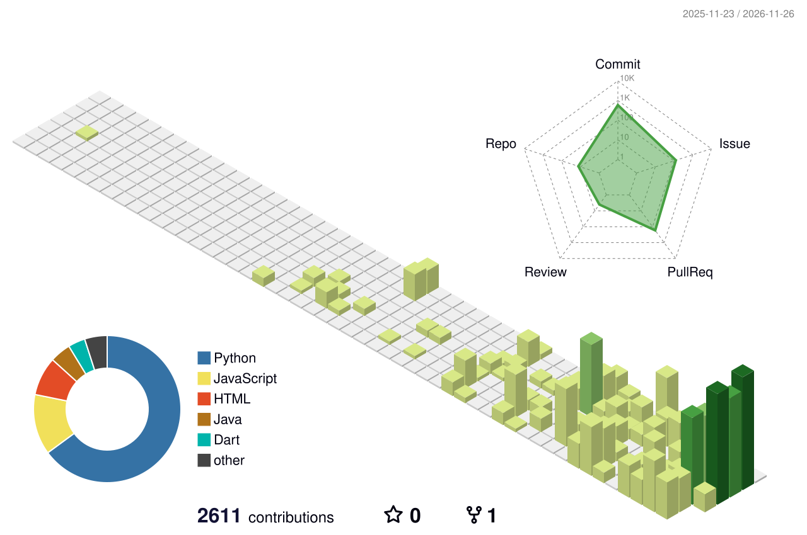</picture>

  

  
  

### Contact 

Email: [cristianyesidmquiroga@gmail.com](mailto:cristianyesidmquiroga@gmail.com). I reply within 24 hours.

  
  

## Sobre mí 

- Desarrollador **full-stack** en formación: Tecnólogo en Análisis y Desarrollo de Software (SENA).
- Construyo sistemas completos: base de datos, API, interfaz y despliegue con Docker.
- Ahora construyo [BUStra](https://bustra.proyecto.sbs/), una web para buscar empleo: API en Go, web en Flask y extensión de Chrome.
- Hice dos veces un control de acceso, en Flask y en Spring Boot + React, con más de 1.500 pruebas entre las dos versiones.
- En línea: [bustra.proyecto.sbs](https://bustra.proyecto.sbs/), [esena.proyecto.sbs](https://esena.proyecto.sbs/auth/login), [nuestroclima.co](https://nuestroclima.co/), [Observatorio Gran Santander](https://observatoriogransantander.co/) y [AgroGestión](https://agrogestion.proyecto.sbs/).
- Administro mi propio VPS Linux con Coolify (más de 20 aplicaciones y bases de datos) y runners propios de GitHub Actions; cada PR pasa por CodeQL, Dependabot y Gitleaks.
- Aprendo blockchain: contratos en Solidity con Hardhat y OpenZeppelin.
- Soy desarrollador junior y busco prácticas para completar mis estudios y seguir construyendo software.

 

Soy desarrollador full-stack en formación (Tecnólogo en Análisis y Desarrollo de Software, SENA) y construyo sistemas web completos de principio a fin: base de datos, API, interfaz y despliegue. Lo que más me importa es que lo que hago sea seguro, esté probado y se pueda explicar; por eso cada proyecto trae pruebas automáticas, documentación y una configuración Docker para que cualquiera pueda ponerlo a correr.

Uno de mis proyectos más grandes es un sistema de control de acceso para un centro de formación que construí dos veces: primero en Flask y después como API en Spring Boot con frontend en React. Migré las pruebas una por una de una versión a la otra para comprobar que las dos se comportan igual.

## Proyectos 

  <a href="https://bustra.proyecto.sbs/"><picture><source media="(prefers-color-scheme: dark)" srcset="https://raw.githubusercontent.com/cristianyesidmquiroga-tech/cristianyesidmquiroga-tech/main/img/proyectos/bustra-oscuro.svg"></picture></a>
  <a href="https://observatoriogransantander.co/"><picture><source media="(prefers-color-scheme: dark)" srcset="https://raw.githubusercontent.com/cristianyesidmquiroga-tech/cristianyesidmquiroga-tech/main/img/proyectos/observatorio-oscuro.svg"></picture></a>
  <a href="https://esena.proyecto.sbs/auth/login"><picture><source media="(prefers-color-scheme: dark)" srcset="https://raw.githubusercontent.com/cristianyesidmquiroga-tech/cristianyesidmquiroga-tech/main/img/proyectos/acceso-oscuro.svg"></picture></a>
  <a href="https://nuestroclima.co/"><picture><source media="(prefers-color-scheme: dark)" srcset="https://raw.githubusercontent.com/cristianyesidmquiroga-tech/cristianyesidmquiroga-tech/main/img/proyectos/clima-oscuro.svg"></picture></a>

**[BUStra](https://bustra.proyecto.sbs/)** · Go, PostgreSQL, Flask, Redis, Cloudflare, extensión de Chrome (sitio en línea, código privado)
Web colombiana para buscar empleo. Lee las alertas de empleo que la persona ya recibe en su correo (LinkedIn, Computrabajo), las junta sin repetir, las compara con su hoja de vida y le dice qué cumple y qué le falta en cada oferta; también arma la carta para postular. La API en Go maneja cuentas con app autenticadora, hoja de vida, planes con pago por transferencia, casos de ayuda y correos de aviso antes de que venza el plan. La web en Flask usa Redis para limitar intentos y Cloudflare Turnstile contra bots, y un Worker de Cloudflare pasa a la API los correos de alertas. La extensión de Chrome (Manifest V3, solo pide `storage`) llena el formulario del portal con un clic y deja que la persona revise y envíe. El CI corre en runners propios dentro de mi VPS.

**[Observatorio Agropecuario del Gran Santander](https://observatoriogransantander.co/)** · Python, Django, PostgreSQL, Redis, Docker (sitio en línea, hecho para ASPROVEL)
Sitio público con mapa, indicadores y datos descargables en CSV y XLSX. Más de 5.500 productores visitados en 69 municipios. Un único módulo de privacidad publica solo agregados por municipio, nunca datos de personas, y está cubierto por pruebas.

**[API de control de acceso](https://github.com/cristianyesidmquiroga-tech/spring)** · Java, Spring Boot, PostgreSQL, Flyway, Testcontainers
API REST por capas para un centro de formación: carnet digital, control de portería, asistencia a clase, mensajería y soporte. Tiene login con JWT, permisos que salen del rol y el cargo, verificación de correo, recuperación de contraseña, CAPTCHA, límite de peticiones y registro de auditoría. 73 endpoints, 7 migraciones de base de datos, más de 700 pruebas automáticas y un pipeline de CI con informes de cobertura.

**[Frontend de control de acceso](https://github.com/cristianyesidmquiroga-tech/react)** · React, Vite
Aplicación de una sola página para esa API: rutas protegidas, navegación según el rol, escáner QR para la portería, importación masiva de usuarios, tema claro y oscuro y modales accesibles.

**[Sistema de control de acceso (Flask)](https://github.com/cristianyesidmquiroga-tech/porteria-2)** · Flask, PostgreSQL, Docker, Coolify
La primera versión full-stack del mismo sistema: módulos de administración, portería y coordinación, carnets digitales con código de barras, respaldos mensuales en Excel y manuales de usuario. Más de 800 pruebas organizadas por módulo, por rol y por vista.

**[Monitoreo del clima](https://nuestroclima.co/)** · Flask, Go, React, PostgreSQL, Redis, Docker Compose (sitio en línea)
Recoge estaciones meteorológicas, alertas hidrológicas e imágenes satelitales diarias de la NASA, y publica un panel, un mapa de lluvias y un reporte semanal de la región con exportación a PDF y Excel. Siete contenedores con límites de memoria y CPU. Ahora suma una [API en Go](https://github.com/cristianyesidmquiroga-tech/nuestroclima-backend-go) (chi y pgx) y un [panel en React](https://github.com/cristianyesidmquiroga-tech/nuestroclima-frontend-react), las dos sobre un mismo contrato OpenAPI. [Código](https://github.com/cristianyesidmquiroga-tech/Sistema_Clima).

**[AgroGestión](https://agrogestion.proyecto.sbs/)** · FastAPI, PostgreSQL, SQLAlchemy, React, Flutter (sitio en línea)
Gestión de cultivos y finca: siembras, mano de obra, insumos, cosechas y flujo de caja, desde el celular y también sin señal. [Código](https://github.com/cristianyesidmquiroga-tech/agrogestion).

## Stack 

| Tecnología | Lo mejor que he hecho con ella |
|---|---|
| [Go](https://go.dev) | API de BUStra: cuentas, hoja de vida, pagos, casos de ayuda, alertas de empleo y comparación de cada oferta con la hoja de vida, con migraciones que se aplican al arrancar. |
| [Java](https://dev.java) | API con 73 endpoints y más de 700 pruebas automáticas; también un CRUD de cine con Servlets y JSP. |
| [Spring Boot](https://spring.io/projects/spring-boot) | Seguridad con JWT y permisos por rol y cargo, 7 migraciones, documentación OpenAPI y CI con informes de cobertura, todo en una sola API. |
| [Python](https://www.python.org) | Base de dos sistemas en línea (carnets y clima) y de procesos automáticos que recogen datos de estaciones y satélites y generan reportes en Excel y PDF. |
| [Flask](https://flask.palletsprojects.com) | Web de BUStra en línea en [bustra.proyecto.sbs](https://bustra.proyecto.sbs/); sistema de carnets con 11 roles y más de 800 pruebas, en línea en [esena.proyecto.sbs](https://esena.proyecto.sbs/auth/login), y monitoreo del clima en [nuestroclima.co](https://nuestroclima.co/). |
| [React](https://react.dev) | Frontend con rutas protegidas por rol, escáner QR, importación masiva y modales accesibles, conectado a la API de Spring Boot. |
| [PostgreSQL](https://www.postgresql.org) | Base de datos de los sistemas en línea, con migraciones versionadas (Flyway y Alembic) y pruebas en CI contra PostgreSQL. |
| [Docker](https://www.docker.com) | Todo lo que publico corre en contenedores en mi propio VPS con Coolify: más de 20 aplicaciones y bases de datos, y nueve runners de CI. El sistema del clima usa siete contenedores con límites de memoria y CPU. |
| [Linux](https://www.kernel.org) | Administro mi propio VPS Linux: ahí despliego mis proyectos con Coolify y corren los runners de GitHub Actions. |
| [GitHub Actions](https://github.com/features/actions) | Cada push ejecuta las pruebas: Testcontainers con PostgreSQL en Spring y pytest contra PostgreSQL en Flask. En BUStra corren en runners propios dentro de mi VPS. |
| [CodeQL](https://codeql.github.com) | Análisis "Security and quality" en cada PR de mis repos; no se fusiona nada con alertas abiertas. |
| [Dependabot](https://docs.github.com/es/code-security/dependabot) | Actualiza dependencias y actions en 15 repositorios; reviso cada PR antes de fusionarlo. |
| [Gitleaks](https://gitleaks.io) | Busca secretos en cada PR para que ninguna clave llegue al historial. |
| [Cloudflare](https://www.cloudflare.com) | Turnstile contra bots en los formularios de BUStra y un Worker que pasa a la API los correos de alertas de empleo. |
| [Redis](https://redis.io) | Caché del monitoreo del clima para aliviar las consultas costosas. |
| [JavaScript](https://developer.mozilla.org/es/docs/Web/JavaScript) | Extensión de Chrome de BUStra (Manifest V3) que llena formularios de empleo con un clic, y vistas interactivas del sistema de carnets, con un archivo por vista. |
| [Vite](https://vite.dev) | Compila los frontends en React y los deja listos para Docker. |
| [Solidity](https://soliditylang.org) | Contratos de estudio con Hardhat y OpenZeppelin: un registro de huellas con sellado firmado (EIP-712) y un contrato de garantía, revisados con Slither. |
| [MySQL](https://www.mysql.com) | CRUD de cine en Java EE. |

## Cómo trabajo 

Cada proyecto pasa por las mismas etapas, y cada etapa deja algo que se puede revisar.


1. **Analizo.** Defino qué se va a construir, para quién, por qué y qué hace falta. Si algo no está claro, lo pregunto antes de programar. Resultado: requisitos escritos.
2. **Investigo.** Busco ideas, miro cómo resuelven el problema otros sistemas parecidos y comparo opciones (tecnologías, estructura, riesgos). Resultado: decisiones con una razón detrás.
3. **Planeo y compruebo el plan.** Escribo el plan y lo verifico contra los requisitos antes de tocar código. Cambiar un plan es barato; cambiar código terminado, no.
4. **Construyo por partes.** Módulo por módulo, con pruebas desde el primero.
5. **Audito cada vista.** Trato cada pantalla como una pequeña auditoría de seguridad. Reviso qué rol puede entrar, qué datos recibe y qué pasa si alguien envía datos manipulados: permisos por rol, validación en el servidor, inyección, sesiones y cookies, límite de peticiones y manejo de secretos. Después pruebo la vista con todos los perfiles de usuario, tanto lo que permite como lo que debe negar.
6. **Documento y entrego.** La estructura, el despliegue y la operación quedan escritos para que otra persona pueda correr el proyecto con `docker compose up`.

## Qué puedo hacer por ti 

- Páginas y sitios web para negocios, con panel de administración.
- Aplicaciones web a la medida y APIs REST.
- Diseño de bases de datos y migraciones.
- Despliegue con Docker y Coolify.
- Automatización de reportes en Excel y PDF.
- Corrección de errores, revisión de código y revisión de seguridad.

## Ahora mismo 

Estudio en el SENA (ADSO) por las tardes y, como desarrollador junior, busco mi etapa práctica (también puede ser por contrato de aprendizaje) para completar mis estudios. Desde ya puedo trabajar por las mañanas, de 7:00 a 11:00 hora de Colombia, y tengo tiempo completo desde el 26 de abril de 2027. Remoto, o presencial en Bogotá o Bucaramanga. Ahora mismo construyo BUStra (Go, Flask y una extensión de Chrome). Estoy aprendiendo blockchain (contratos en Solidity con Hardhat y OpenZeppelin) y administro mi propio VPS para publicar mis proyectos, con runners propios de GitHub Actions.

## Actividad 

  <picture>
    <source media="(prefers-color-scheme: dark)" srcset="https://raw.githubusercontent.com/cristianyesidmquiroga-tech/cristianyesidmquiroga-tech/salida/profile-3d-contrib/profile-night-green.svg">
    
  </picture>

  

  
  

## Contacto 

Correo: [cristianyesidmquiroga@gmail.com](mailto:cristianyesidmquiroga@gmail.com). Respondo en menos de 24 horas.

  
  

